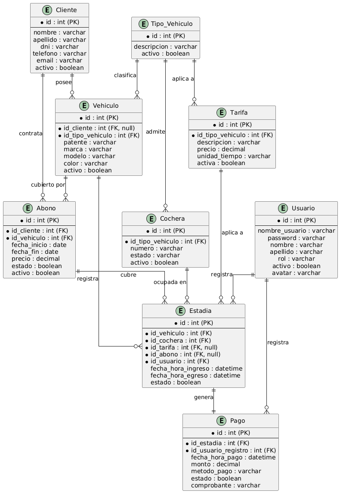

# 🚗 PROYECTO: SISTEMA DE GESTIÓN DE ESTACIONAMIENTO

Sistema web para la gestión integral de un estacionamiento, desarrollado como Proyecto Integrador Final.

---

## 👥 Integrantes del Grupo

* **Myriam Alvarez**

  * Email: [myriamalvarez1006@gmail.com](mailto:myriamalvarez1006@gmail.com)
  * GitHub: [@myriamalvarez](https://github.com/myriamalvarez)
  * Discord: myriamalvarez1006
* **Leandra Campos**

  * Email: [camposleandra149@gmail.com](mailto:camposleandra149@gmail.com)
  * GitHub: [@Leandra25](https://github.com/Leandra25)
  * Discord: Leandra 7827

---

## 📦 Alcance del Proyecto y Funcionalidades

El sistema tiene como objetivo administrar las operaciones de un estacionamiento, incluyendo el ingreso, la permanencia y el egreso de vehículos.

Contempla la gestión de clientes, vehículos, tipos de vehículos, cocheras, tarifas, abonos, estadías y pagos con comprobantes digitales. También prevé la administración de usuarios, perfiles y permisos según el rol.

---

## 📌 Módulos del Sistema

### 🗄️ Base de Datos

* Base de datos relacional MySQL.
* Persistencia de la información de las entidades.
* Relaciones entre las entidades del sistema.
* Acceso a datos mediante Entity Framework Core.

### 👥 Clientes

* Registro y modificación de datos personales.
* Consulta de clientes.
* Asociación de clientes con sus vehículos.
* Gestión de los datos necesarios para identificar a los titulares de vehículos registrados.

### 🚘 Tipos de Vehículos

* Administración de tipos de vehículos, como automóviles, motocicletas y camionetas.
* Asociación de cada vehículo con su tipo.
* Gestión del estado activo o inactivo de los tipos.

### 🚗 Vehículos

* Registro de patente, marca, modelo y color.
* Asociación con un tipo de vehículo.
* Asociación opcional con un cliente para permitir el ingreso de vehículos ocasionales.

### 🅿️ Cocheras

* Registro y administración de cocheras.
* Identificación de cada cochera.
* Definición del tipo de vehículo compatible.
* Control de disponibilidad y ocupación.

### 💲 Tarifas

* Configuración de tarifas por tipo de vehículo.
* Definición de unidades de tiempo, como hora o día.
* Registro del importe correspondiente.

### 🎫 Abonos

* Registro de abonos asociados a vehículos con cliente registrado.
* Definición de fechas de inicio y vencimiento.
* Registro del importe del abono.
* Validación de la vigencia para determinar si corresponde cobrar una estadía por tarifa.

### 🕒 Estadías e Ingreso/Egreso

* Registro de fecha y hora de ingreso.
* Asociación del vehículo, la cochera y el usuario que registra la operación.
* Control de vehículos dentro del estacionamiento.
* Registro de fecha y hora de salida.
* Cálculo de la duración y del importe correspondiente.
* Liberación de la cochera al finalizar la estadía y completar el proceso de pago.

### 💳 Pagos y Comprobantes

* Registro de pagos asociados a las estadías.
* Registro de fecha, importe y medio de pago.
* Asociación con el usuario que procesa el pago.
* Almacenamiento de comprobantes digitales, como imágenes o archivos PDF.

### 🔐 Usuarios, Autenticación y Autorización

El sistema contempla usuarios con perfiles y permisos diferenciados.

**Administrador**

* Administración de usuarios y datos generales.
* Gestión de cocheras, tarifas, tipos de vehículos y abonos.
* Acceso a las funcionalidades administrativas autorizadas.

**Empleado**

* Registro de ingresos y egresos.
* Consulta de disponibilidad.
* Gestión de pagos y comprobantes, según los permisos asignados.


---

## 🖥️ Interfaz de Usuario

La aplicación está desarrollada con ASP.NET Core MVC.

### Tecnologías utilizadas

* **C# y ASP.NET Core MVC**
* **Entity Framework Core**
* **MySQL**
* **Razor**
* **HTML, CSS y JavaScript**
* **Vue.js y AJAX/JSON**, para los requisitos de interacción dinámica.
* **Git y GitHub**

La interfaz contempla formularios de gestión, consultas y operaciones sobre las distintas entidades. Los requisitos de ABM mediante AJAX, paginación y búsqueda asíncrona se verificarán durante el desarrollo.

---

# 📐 Modelado de Datos

El modelo contempla entidades como Usuario, Cliente, Vehículo, Tipo de Vehículo, Cochera, Tarifa, Abono, Estadía y Pago.


### 📐 Diagrama Entidad-Relación (DER)




---

# 🚀 Guía de Instalación y Ejecución

## 1. 📥 Clonar el repositorio

Repositorio del proyecto:

https://github.com/myriamalvarez/Estacionamiento

### Opción A — Desde Visual Studio Code

1. Abrir Visual Studio Code.
2. Abrir una terminal desde **Terminal → Nueva terminal**.
3. Ejecutar:

```bash
git clone https://github.com/myriamalvarez/Estacionamiento.git
cd Estacionamiento
code .
```

También se puede clonar desde GitHub Desktop utilizando **File → Clone repository...**, ingresando la URL del repositorio.

## 2. 🧰 Requisitos previos

Instalar las siguientes herramientas:

* Git.
* Visual Studio Code.
* SDK de .NET 10.
* MySQL Server o una instalación compatible de MySQL/MariaDB.
* MySQL Workbench, phpMyAdmin u otra herramienta para administrar la base de datos.

## 3. 🗄️ Configurar la base de datos

1. Iniciar el servidor MySQL.
2. Abrir la herramienta de administración elegida.
3. Importar y ejecutar el archivo `estacionamiento_db.sql` incluido en el repositorio.
4. Verificar el nombre de la base de datos creada.
5. Comprobar que la cadena de conexión coincida con la configuración local.

## 4. 🔗 Configurar la conexión

Abrir el archivo `appsettings.json` y revisar la cadena de conexión.

Ejemplo orientativo:

```json
"ConnectionStrings": {
  "DefaultConnection": "Server=localhost;Port=3306;Database=estacionamiento_db;Uid=TU_USUARIO;Pwd=TU_CLAVE;"
}
```

Reemplazar `TU_USUARIO` y `TU_CLAVE` por las credenciales locales. Los nombres de la conexión y de la base de datos deben coincidir con los utilizados por el proyecto y el script SQL.

**Importante:** no subir contraseñas personales ni otros datos sensibles al repositorio.

## 5. 📦 Restaurar las dependencias

Desde la terminal de Visual Studio Code, ubicarse en la carpeta que contiene el archivo `.csproj` y ejecutar:

```bash
dotnet restore
```

## 6. 🔨 Compilar el proyecto

Ejecutar:

```bash
dotnet build
```


## 7. ▶️ Ejecutar la aplicación

Ejecutar:

```bash
dotnet run
```

La terminal mostrará la dirección local para acceder a la aplicación. Abrir esa URL en el navegador.

La dirección y el puerto pueden variar según la configuración del proyecto.

---

# 📋 Matriz de Cumplimiento de la Consigna

La siguiente matriz permite identificar los requisitos solicitados y las evidencias que deberán incorporarse al repositorio. Los estados se actualizarán luego de revisar el código y realizar las pruebas correspondientes.

| Requisito                                                                         | Estado                               | Evidencia esperada                           |
| --------------------------------------------------------------------------------- | ------------------------------------ | -------------------------------------------- |
| Modelo de datos con al menos 6 entidades relacionadas y las relaciones requeridas | 🔎 Pendiente de verificar            | `Models/`, configuración de relaciones y DER |
| Login y logout                                                                    | ⏳ Pendiente de implementar/verificar | Autenticación y cierre de sesión             |
| Seguridad y autorización por roles                                                | ⏳ Pendiente de implementar/verificar | Atributos de autorización y validaciones     |
| Funcionalidad restringida según el rol                                            | ⏳ Pendiente de implementar/verificar | Controladores y pruebas con ambos roles      |
| Avatar personalizado de usuario                                                   | ⏳ Pendiente de implementar/verificar | Perfil y almacenamiento de imagen            |
| Manejo de archivos adicional al avatar                                            | 🔎 Pendiente de verificar            | Carga y almacenamiento de comprobantes       |
| ABM completo con Vue.js o tecnología reactiva y AJAX/JSON sin recargar la página  | 🔎 Pendiente de verificar            | Vistas, JavaScript y endpoints               |
| Paginación del lado del servidor para los listados principales                    | 🔎 Pendiente de verificar            | Consultas y controladores                    |
| Búsqueda asíncrona de entidades relacionadas                                      | 🔎 Pendiente de verificar            | Endpoints y formularios de búsqueda          |
| Web API REST protegida con JWT                                                    | ⏳ Pendiente de implementar/verificar | Controladores API y configuración JWT        |
| Colección de Postman, Bruno o Insomnia si la web no consume la API directamente   | 📌 Pendiente de determinar           | Colección de solicitudes                     |
| Repositorio público con archivo `.gitignore`                                      | 🔎 Pendiente de verificar            | Repositorio de GitHub                        |
| Diagrama DER o diagrama de clases                                                 | 📌 Pendiente de incorporar/verificar | Archivo de documentación                     |
| README con descripción y matriz de evidencias                                     | 📝 Documentación en preparación      | `README.md`                                  |
| Script SQL con datos de prueba para la entrega final                              | 🔎 Pendiente de verificar            | `estacionamiento_db.sql`                     |
| Credenciales de prueba para cada rol                                              | 📌 Pendiente de preparar/verificar   | Documentación de acceso                      |

**Referencias de estado:**

* ✅ Cumplido y probado.
* 🔎 Pendiente de verificar en el código.
* ⏳ Pendiente de implementar o completar.
* 📌 Pendiente de incorporar o determinar.
* 📝 En preparación.


## 🚧 Estado del Proyecto

El proyecto se encuentra en desarrollo. La matriz de cumplimiento se utilizará para registrar el avance real de cada requisito, diferenciando las funcionalidades implementadas de aquellas que todavía deben desarrollarse o probarse.
