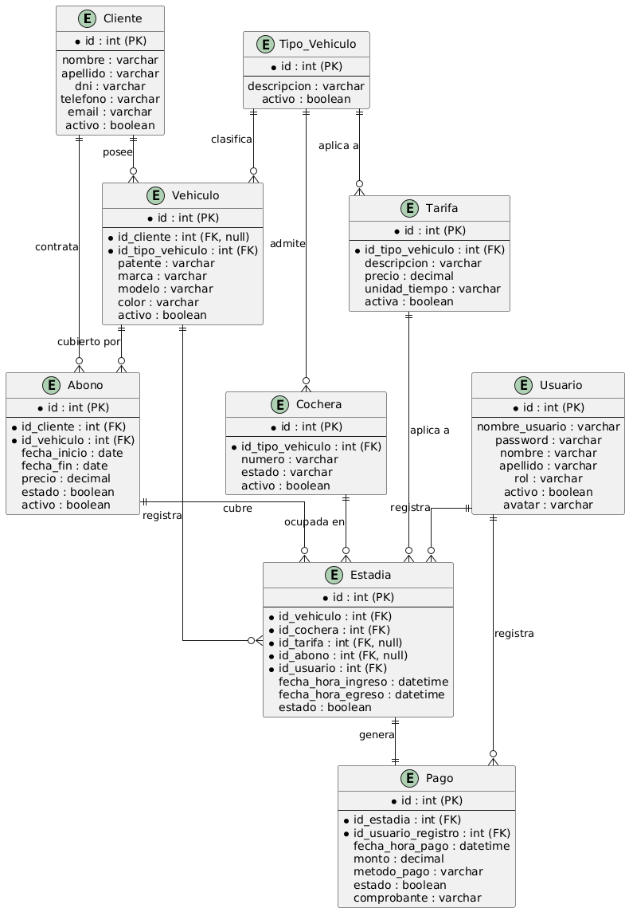

# Estacionamiento — Sistema de gestión de cocheras

Aplicación web desarrollada con **ASP.NET Core MVC** (EF Core + MySQL) para la materia *Laboratorio de Programación II* (TUDS – ULP).

> **Integrantes:** _Myriam Alvarez_ y _Leandra Campos_

## 1. Descripción y problema que resuelve

Un estacionamiento necesita saber, en todo momento, **qué vehículos hay adentro, qué cocheras están libres u ocupadas y cuánto hay que cobrar** al salir. Hacerlo en papel genera errores de cobro y no deja historial.

El sistema permite:

- Registrar el **ingreso** de un vehículo, asignándole automáticamente una cochera libre compatible con su tipo. Si no hay lugar, el ingreso se rechaza.
- Registrar el **egreso** y calcular el importe según el tiempo de permanencia (por hora hasta 24 h, por día después) y la tarifa del tipo de vehículo. Si el vehículo tiene un **abono vigente**, no se cobra.
- Cobrar y guardar el **pago** con su **comprobante digital** (PDF o imagen).
- Gestionar clientes, vehículos, abonos, cocheras, tarifas y usuarios, con permisos según el **rol**.
- Consultar la disponibilidad y la recaudación desde una **Web API protegida con JWT**.

## 2. Tecnologías

| Capa | Tecnología |
|---|---|
| Backend | ASP.NET Core MVC, EF Core (sin migraciones) + Pomelo MySQL, `EFCore.NamingConventions` |
| Frontend | Razor, Bootstrap 5, **Vue 3** (CDN) con `fetch` / Ajax |
| Seguridad | JWT (en cookie HttpOnly para la web, en header `Bearer` para la API), PBKDF2 + sal |
| Base de datos | MySQL / MariaDB (XAMPP) |

## 3. Modelo de datos



9 tablas: `tipo_vehiculo`, `cliente`, `vehiculo`, `cochera`, `tarifa`, `abono`, `usuario`, `estadia`, `pago`.
`estadia` depende de otras entidades (`vehiculo`, `cochera`, `usuario`, y opcionalmente `tarifa` y `abono`) y tiene una relación 1:1 con `pago`. Un cliente tiene muchos vehículos (1:N).

## 4. Cómo ejecutarlo

1. Importar `estacionamiento_db.sql` en MySQL (phpMyAdmin / XAMPP).
2. Revisar `appsettings.json`: cadena de conexión `DefaultConnection`, `Salt` y `TokenAuthentication`.
3. Ejecutar:
   ```bash
   dotnet restore
   dotnet run
   ```
4. Abrir `http://localhost:5151`.

**Usuarios de prueba**:

| Rol | Usuario | Contraseña |
|---|---|---|
| Administrador | `admin` | `Admin123` |
| Empleado | `empleado` | `Empleado123` |

**Permisos por rol**

| Funcionalidad | Administrador | Empleado |
|---|:-:|:-:|
| Ingresos, egresos y cobros | ✅ | ✅ |
| Clientes, vehículos y abonos (alta/edición) | ✅ | ✅ |
| Eliminar registros, anular pagos | ✅ | ❌ |
| Tarifas, tipos de vehículo, alta/edición de cocheras | ✅ | ❌ |
| Gestión de usuarios | ✅ | ❌ |
| Editar el propio perfil y avatar | ✅ | ✅ |
| API: recaudación | ✅ | ❌ (403) |

## 5. Matriz de evidencias de requisitos mínimos

> Los enlaces apuntan al código dentro de este repositorio. Las evidencias (capturas/GIF) están en `Documentos/evidencias/`.

| Requerimiento mínimo | Estado | Enlace al código / controladores | Evidencia |
|---|:-:|---|---|
| **1. Modelo de datos** (≥ 6 tablas, relación 1:N y entidad que depende de otras) | ✅ Cumplido | [EstacionamientoContext.cs](Data/EstacionamientoContext.cs) · [Estadia.cs](Models/Estadia.cs) (depende de Vehículo + Cochera + Usuario) | DER en [Documentos/DER_Estacionamiento.png](Documentos/DER_Estacionamiento.png) |
| **2. Login/Logout, roles, restricción por rol y avatar** | ✅ Cumplido | Login: [UsuarioController.cs#L41](Controllers/UsuarioController.cs#L41) · Logout: [#L71](Controllers/UsuarioController.cs#L71) · Políticas/roles: [Program.cs#L64](Program.cs#L64) · Solo admin: [TarifaController.cs#L10](Controllers/TarifaController.cs#L10) · Avatar: [UsuarioController.cs#L252](Controllers/UsuarioController.cs#L252) | [GIF: perfil con avatar y acceso denegado al empleado](Documentos/evidencias/02-avatar-acceso-denegado.gif) |
| **3. Manejo de archivos** (adicional al avatar): comprobante de pago | ✅ Cumplido | Validación: [PagoController.cs#L60](Controllers/PagoController.cs#L60) · Guardado en `wwwroot/uploads/comprobantes`: [#L88](Controllers/PagoController.cs#L88) · Vista: [Pago/Create.cshtml](Views/Pago/Create.cshtml) | [GIF: subida de comprobante](Documentos/evidencias/03-comprobante.gif) |
| **4. ABM completo en Vue.js + AJAX** (alta, baja, modificación y listado sin recargar) — *Vehículos* | ✅ Cumplido | Vue: [Vehiculo/Index.cshtml](Views/Vehiculo/Index.cshtml) (modificación [#L222](Views/Vehiculo/Index.cshtml#L222), guardar [#L237](Views/Vehiculo/Index.cshtml#L237), baja [#L261](Views/Vehiculo/Index.cshtml#L261)) · Endpoints JSON: [ListarJson #L51](Controllers/VehiculoController.cs#L51), [GuardarJson #L119](Controllers/VehiculoController.cs#L119), [EliminarJson #L171](Controllers/VehiculoController.cs#L171) | [GIF: ABM de vehículos sin recarga](Documentos/evidencias/04-abm-vue.gif) |
| **5. Paginado por servidor** | ✅ Cumplido | `Skip/Take` en la consulta: [VehiculoController.cs#L66](Controllers/VehiculoController.cs#L66). Mismo patrón en Cliente, Cochera, Abono, Usuario y Estadía (`ListarJson`, `ActivasJson`, `HistorialJson`) | [Captura: inspector de red con `pagina=2`](Documentos/evidencias/05-paginado-red.png) |
| **6. Selección asíncrona de entidades relacionadas** | ✅ Cumplido | Cliente: [ClienteController.Buscar #L123](Controllers/ClienteController.cs#L123) · Vehículo: [VehiculoController.BuscarPorPatente #L195](Controllers/VehiculoController.cs#L195) · Uso en Vue: [Vehiculo/Index.cshtml#L271](Views/Vehiculo/Index.cshtml#L271) · También en [Abono/_Formulario.cshtml](Views/Abono/_Formulario.cshtml) y [Estadia/Ingreso.cshtml](Views/Estadia/Ingreso.cshtml) | [GIF: búsqueda asíncrona de cliente](Documentos/evidencias/06-busqueda-asincrona.gif) |
| **7. Web API REST con JWT** | ✅ Cumplido | Login/token: [Api/AuthController.cs#L32](Api/AuthController.cs#L32), [ServicioSeguridad.GenerarToken #L43](Servicios/ServicioSeguridad.cs#L43) · Endpoints: [Api/EstacionamientoController.cs](Api/EstacionamientoController.cs) · Configuración JWT: [Program.cs#L26](Program.cs#L26) | Colección de Postman: [API-Estacionamiento.postman_collection.json](Documentos/API-Estacionamiento.postman_collection.json) + [Captura: Postman con Bearer Token (200)](Documentos/evidencias/07-postman-bearer.png) · [Captura: 403 con rol Empleado](Documentos/evidencias/07b-postman-403.png) |

## 6. Web API (JWT)

La web no consume la API de forma nativa, por eso se adjunta la colección de Postman.

| Método | Ruta | Acceso |
|---|---|---|
| POST | `/api/auth/login` | Público. Devuelve el token |
| GET | `/api/estacionamiento/disponibilidad` | Token |
| GET | `/api/estacionamiento/estadias-activas?pagina=1` | Token |
| GET | `/api/estacionamiento/estadia-activa/{patente}` | Token |
| GET | `/api/estacionamiento/recaudacion?fecha=2026-10-09` | Token con rol Administrador |

Uso: importar la colección en Postman, ejecutar **Login administrador** (guarda el token solo) y luego los demás requests.

## 7. Estructura

```
Api/            Controllers de la Web API (JWT)
Controllers/    Controllers MVC
Data/           DbContext
Models/         Entidades
Servicios/      Hash de contraseñas y generación del JWT
Views/          Vistas Razor (+ Vue en los listados)
wwwroot/        Archivos estáticos y uploads (avatares, comprobantes)
Documentos/           DER, colección de Postman y evidencias
```
